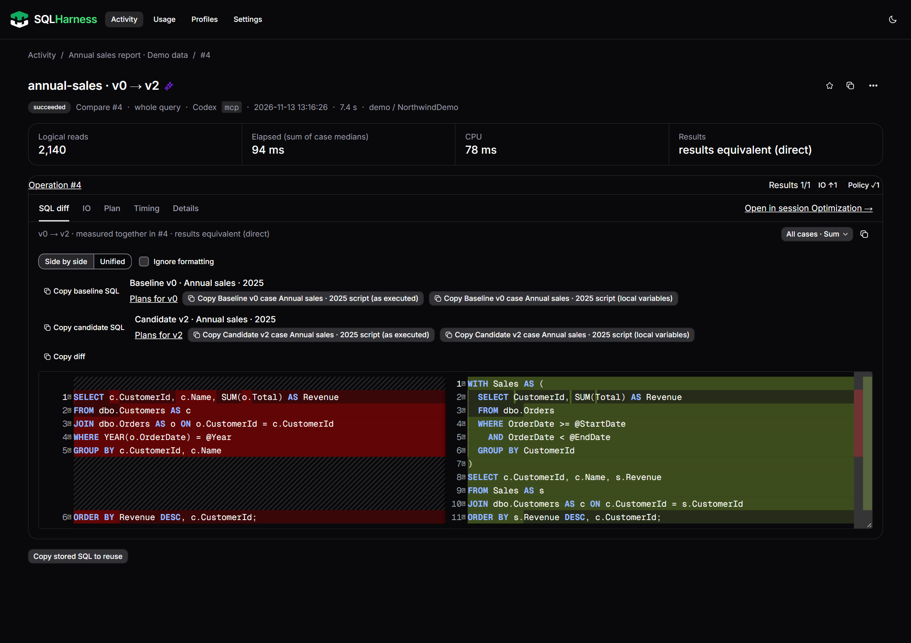

# SQLHarness v0.4.0

SQLHarness now brings SQL optimization evidence into a local browser dashboard, alongside its CLI and MCP server. Compare proposed rewrites, check their results for the tested inputs, and follow the attempts that led to a selected query version.

## Highlights

- **Local dashboard:** browse activity and sessions, compare retained SQL versions, review elapsed time, CPU and IO, and copy comparisons as Markdown.
- **Clearer optimization evidence:** result equivalence, IO changes and policy outcomes are separate; selected cases and incomplete evidence retain their context.
- **Coding-agent workflows:** MCP support and a bundled skill connect SQL inspection and measurement to the optimization workflow.
- **Guarded mutations:** persistent SQL changes use the mutation workflow and the operator's dashboard approval policy.
- **SQL Server, Azure SQL and PostgreSQL:** engine-specific measurements, compact execution-plan inspection, and bounded output.
- **Demo walkthrough:** the README now shows a real dashboard populated with explicitly synthetic data, with a reproducible source-checkout fixture.

## Downloads

Choose `sqlharness-win-x64.zip`, `sqlharness-linux-x64.tar.gz`, or `sqlharness-osx-arm64.tar.gz`. Each archive contains a self-contained binary with the .NET 10 runtime included. Verify its SHA-256 digest against `SHA256SUMS`, extract it, and put `sqlharness` on PATH. Unix users should ensure the extracted binary is executable.

`sqlharness-skill.zip` contains the SQLHarness skill. Extract its `sqlharness` folder into the skills directory supported by your coding agent. Configure the MCP server separately using the README instructions.

## Notes

- **Upgrade from v0.3.1:** the CLI surface has changed. The old `ping`, `schema`, `counts`, `space`, and `gain` commands are no longer registered. Use `query` for inspection SQL, `doctor` for local installation/configuration checks, and `capabilities` to discover the current interface. Update scripts and agent instructions against `--help` before upgrading.
- Comparisons require `--subject` and `--scope` by default; use a stable subject label and `--scope whole` for a whole-query comparison. The `compare.requireContext` setting controls this policy. Restart MCP after changing it.
- Start from the example target configuration and choose the correct engine for each profile. Existing users should review the current README before upgrading across the changes since v0.3.1.
- Result equivalence applies to the supplied test inputs and configured comparison mode; it is not a proof for every possible input.
- SQL, parameter values and execution plans stored in the optional local journal may contain sensitive data. Review journal settings before enabling that storage.
- The screenshot metrics are synthetic demo data, not performance claims.

## Validation

- Binary build revision: `ef7084b820fb22cdada273623a63c1faeddac596`. The release tag also includes subsequent documentation updates and CI test portability fixes; application source is unchanged.
- Windows verification gate passed: UI 570 tests, Core 4,919 passed / 11 skipped, MCP 537 passed / 4 skipped. The unchanged `scripts/verify.ps1` gate was invoked directly under PowerShell without profiles.
- Self-contained single-file builds succeeded for `win-x64`, `linux-x64`, and `osx-arm64`.
- The Windows release binary passed version/help, archive extraction, and embedded-dashboard checks, including all three demo views and asserted comparison metrics.
- Linux and macOS binaries were cross-built on Windows; execution on those operating systems has not been verified in this preparation.
