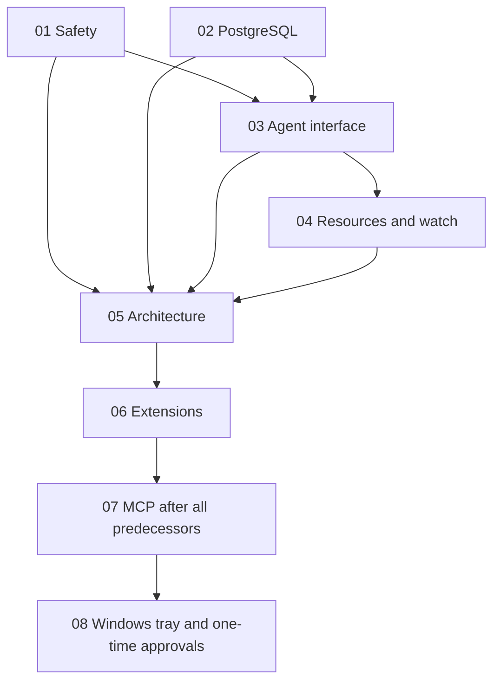

# SQLHarness — 2026-09-26 audit implementation plan

**Status (2026-10-16):** plans 01–07 completed (details and commits in the header of each plan); 08 superseded by plan 073 (dashboard approval), tray deferred. Recording plans does not mean performing the fixes or consenting to database operations.

**Source:** [full audit and offline trial archive](../specs/2026-09-26-project-audit.md), commit `5e655942f4f99f6c84ae47a86ac210c19434b541`.

## Order and dependencies

| Plan | Scope | Dependency |
|---|---|---|
| [01 — SQL safety](2026-09-26-audit-01-sql-safety.md) | DML targets, PG functions, redaction, target in Core | first; quick fixes independent of refactoring |
| [02 — PostgreSQL](2026-09-26-audit-02-postgres-correctness.md) | parameters, TLS, identity, metrics | the parameter and metric tasks may precede 01; agree shared AST changes with 01 |
| [03 — Agent interface](2026-09-26-audit-03-agent-interface.md) | JSON, capabilities, validate, response budget, gain | errors after 01 redaction; validate after 01/02 analysis |
| [04 — Resources and watch](2026-09-26-audit-04-runtime-bounds.md) | deadline, history, messages, memory, unstable test | presentation contract from 03; deadline independent |
| [05 — Architecture](2026-09-26-audit-05-architecture.md) | responsibilities, shared mechanisms, redundant interfaces | after the fixes of 01/02 and after settling the contracts of 03/04 |
| [06 — Extensions](2026-09-26-audit-06-extensions.md) | safe syntax, artifacts, NDJSON, CI, pg_stat_statements | after the proper foundations; some tasks end with a specification |
| [07 — MCP](2026-09-26-audit-07-mcp.md) | local stdio adapter over Core, immutable scope, tools and budgets | **after completion of 01–06**, per the user decision; implemented and documented in `docs/mcp.md` (T7) |
| [08 — Windows tray and approvals](2026-09-26-audit-08-windows-approval-tray.md) | superseded by plan 073 (dashboard approval); tray deferred | status in the plan header |

Do not execute plans concurrently in one directory: the shared files are `SqlHarnessModule.cs`, `Contracts.cs`, `ISqlDialect.cs`, `Renderer.cs`. Each stage should end in a coherent, testable state. When instructed to implement, carry out small tasks and separate local commits; push is not part of these plans. Plan 07 has a separate [MCP specification](../specs/2026-09-26-mcp-adapter-design.md) and does not start before the predecessors are closed.



The diagram shows the integration order of the whole plans. Independent tasks, e.g. fixing the deadline or buffer counting, may be performed earlier in accordance with the dependency table.

## Target division of responsibilities

| Area | Currently | After implementation |
|---|---|---|
| SQL analysis | dialect classifier + T-SQL reference parser + repeated benchmark analysis | one coherent analysis of the proper engine, used by the different modes |
| Lifecycle | an extensive facade and runners referring to its helpers | dispatch facade, operation preparation, command family execution, shared infrastructure |
| Response | full report/summary or a text error | stable result and error, budgeted projection, details on request |
| Artifacts | duplicated staging/publish/cleanup | separate domain writers over shared file publication |

## Common execution rules

- .NET 8, C#, xUnit; preserve both engines: SQL Server and PostgreSQL.
- One invocation has one profile and one variable set. Do not switch the target nor automatically repeat a mutation.
- Persistent DML requires exact consent to the batch and the database as well as both flags; persistent DDL, dynamic SQL and uncontrolled sources remain disallowed.
- Do not implement disabling validation as a workaround for a parser error.
- Perform parser trials offline. Live tests only on explicitly authorized one-time databases; never by default on a user profile.
- Preserve session setup once, one session per matrix cell, parameter-set rotation and a separate PostgreSQL results sidecar.
- Parameter values, SQL and plans remain locally sensitive. The presentation budget must not truncate data used for equivalence.
- Exit codes 0/2/3/4/5/6/7/8 remain compliant; new domain decisions must have a separate explicit contract.
- TLS and machine-format changes are an evolution of the contract. New plans indicate the target direction, but recording them does not change the current AGENTS.md or historical specifications.

## Coverage of all findings

| Finding | Task |
|---|---|
| S1 — OUTPUT INTO | 01/T1 |
| S2 — #temp alias | 01/T1 |
| S3 — PG function effects and hidden sources | 01/T3 |
| S4 — incomplete AST analysis; no evidence of a server-side gap | 01/T3 and 02/T1 |
| S5 — TLS | 02/T2 |
| S6 — leakage of invalid values | 01/T2 |
| B1 — PG parameter parser | 02/T1 |
| B2 — DNS/IP | 02/T2 |
| B3 — buffers, CPU and time precision | 02/T3 |
| B4 — excessive syntax blocking | 06/T1 |
| B5 — watch deadline and history | 04/T1–T2 |
| A1 — JSON errors | 03/T1 |
| A2 — summary and cell size | 03/T3, 04/T2–T3 |
| A3 — help, capabilities, binary drift | 03/T2 |
| A4 — gain and cost of the whole task | 03/T4 |
| Duplication of target rules | 01/T4 |
| Broad dialect, facade, object Report, dead members | 05/T1–T2 |
| Duplication of writers and exception mapping | 05/T2–T3 |
| validate offline | 03/T2 |
| Selective artifacts | 06/T2 |
| Watch NDJSON | 06/T3 |
| CI regression thresholds | 06/T4 |
| pg_stat_statements | 06/T5 |
| Process test timeout | 04/T4 |
| Good existing boundaries and behaviors | the restrictions of all plans, especially 05 |
| MCP from the README roadmap — added at the user's request | 07/T1–T7, after completion of 01–06 |
| Tray and approvals for mutations of our MCP only — added at the user's request | Superseded by plan 073 (dashboard approval); tray deferred |

## State of evidence and closure criterion

Audit: 1404 tests passed, one PID publication timeout; rerunning that test alone passed. NuGet reported no vulnerable dependencies on the audit day. There is no evidence of executing exploits on a server. The results do not replace verification of future implementation.

Each plan contains tasks with checkboxes, files and criteria. When executing, record the commit, the commands run, the actual results and the live tests not performed. Do not mark as complete a task requiring evidence that has not been obtained. The design tasks 01/T3 and 06/T4–T5 have an explicit documentation result before implementing dependent features.

Target offline run after code changes:

```powershell
dotnet test SqlHarness.sln --filter 'FullyQualifiedName!~Integration' --verbosity minimal
dotnet list SqlHarness.sln package --vulnerable --include-transitive
```

When merely recording these documents, check the paths, the completeness of the mapping and the diff; do not run the application test suite again.

## Status of the 06/T4–T5 specifications (documents, not implementations)

- 06/T4: `docs/superpowers/specs/2026-09-26-benchmark-regression-policy.md` — regression decision contract (pass/fail/inconclusive), implementation out of scope.
- 06/T5: `docs/superpowers/specs/2026-09-26-postgres-statement-diagnostics.md` — `pg_stat_statements` diagnostics contract (PG14+, read-only, without `CREATE EXTENSION`, without a window promise, snapshot/delta with invalidation after a reset); SQL Server `qstop` unchanged.
- Both specifications do not change code, stubs, exit codes nor capabilities: the mapping in capabilities only after actual implementation.
