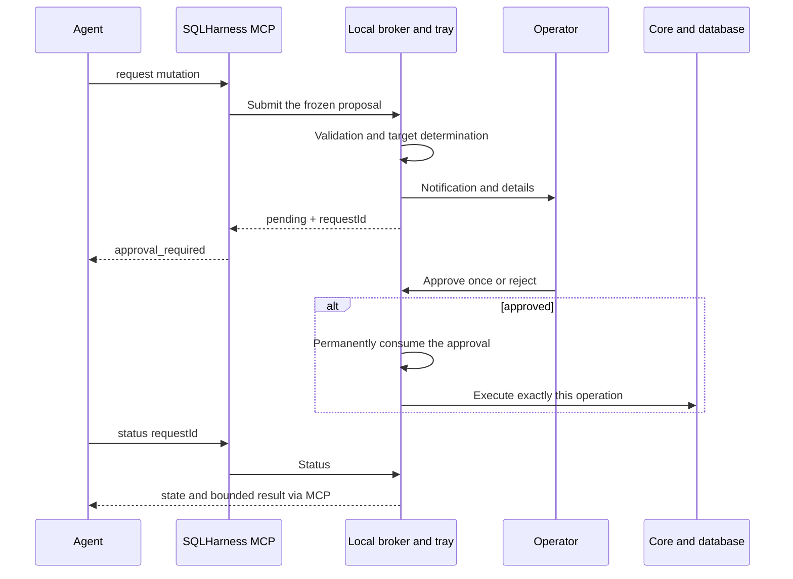

# SQLHarness — Windows tray and one-time approvals for MCP mutations

**Status:** Superseded by plan 073 (dashboard approval); tray deferred.

**Goal:** before a persistent DML reported by SQLHarness MCP, the operator receives a notification and a local preview of the exact operation, then approves it once or rejects it. No decision means no execution.

**Plan:** [08 — Windows approval tray](../plans/2026-09-26-audit-08-windows-approval-tray.md). The [MCP predecessor](2026-09-26-mcp-adapter-design.md) stays read-only in its first version; this document defines its later, explicitly enabled extension.

## 1. Scope and trust boundary

- Only the local SQLHarness MCP and its INSERT/UPDATE/DELETE/MERGE operations on persistent tables, as allowed by the repaired Core. SQL Server and PostgreSQL remain supported.
- No general MCP proxy, no snooping on other applications, no HTTP, no cloud services, no persistent DDL, no arbitrary procedures, no dynamic SQL and no database permission modification.
- The existing CLI keeps its contract; the plan does not promise to block writes performed by another program outside our MCP.
- Threats in scope: model-generated arguments, prompt injection in data, replay, file change after the preview, concurrency, a mistaken profile, timeout and process failure.
- V1 assumes a trusted local system, installed binaries and an operator. A process running as the same Windows user, with the ability to modify the application, read its memory or automate its UI, is not effectively isolated by the tray/named pipe/DPAPI alone. Do not present this solution as a sandbox for arbitrary agent code under the same account.
- Stronger isolation would require a separate system identity and DB account, unavailable to the agent process. That is a separate project, not an implicit installation of a privileged service in this plan. The v1 mechanism must, however, make approval through the MCP API and public IPC impossible.

## 2. Architecture and Windows first

The new `SqlHarness.Approval.Windows` application runs as a user process, without administrator rights and without a Windows service. UI: WinForms NotifyIcon, a request list and a details window. System notifications through the Windows App SDK; pin a version compatible with the framework and the distribution model at implementation time. V1: Windows 11 x64; other Windows versions only after separate verification and an explicit matrix extension.

The approval broker and the state machine are in the platform-independent library `SqlHarness.Approvals`. The tray is the composition root of the broker, the UI, the transport and Core. The MCP server uses the IPC client; it does not receive write credentials from the broker, nor a capability enabling local execution of approved DML. The broker itself executes the frozen request through Core after a click in the local UI. The permissions of accounts already configured in MCP do not change automatically: restricting an account to read-only and separating the broker's credentials require explicit operator configuration. The adapter itself does not grant the process system permissions or existing DB access.

The named pipe serves only Submit/Status/Cancel. There is no Approve method, no approved=true parameter and no MCP tool making a decision. The operator's decision stays inside the application process. Local connection, user ACL, rejection of network clients, verification of the peer PID/session and of the expected installation. Do not treat CurrentUserOnly as confirmation that the peer is our MCP. A versioned handshake and peer verification in both directions are meant to detect a process/pipe mix-up; the same-user restrictions stay explicit. MCP keeps the broker connection between tools/call; ending a single request/status does not close the connection session and does not invalidate a pending approval.

MCP enables the extension through startup `--approval-mode tray` (off by default). Tool arguments must not change this setting. The off mode preserves plan 07. The tray can be started manually; autostart only from an explicit user option, never as a result of tools/call. A closed application means APPROVAL_UNAVAILABLE; MCP does not start it with an argument pretending to be an approval.

## 3. Scope and request immutability

MCP still has the immutable profile and vars from plan 07. The broker independently resolves the same profile from its own trusted configuration and compares engine/server/database and the policy version with the frozen MCP scope. A mismatch means rejection before the notification. The profile is chosen by the operator through configuration/start, not by a mutation tool argument. Credential binding must point at the same target; the password/token is not part of the preview or the digest.

The broker reads SQL and typed parameters once, validates them through Core and holds an immutable object in memory. The IPC call does not supply an arbitrary path for the broker to read: the controlled MCP reader from 07 materializes the file, the broker receives the content. A later change to the source file does not change the operation being approved.

The identifier and digest bind: the protocol/contract version, the broker scope, the resolved engine and target, the exact batch text, parameter names/types/null/value, the timeout, result limits, the execution policy and the expiry deadline. Do not normalize whitespace/literals in a way that changes the SQL. Encode types and lengths canonically. A persistent HMAC digest with an installation key, so that the journal does not make guessing short parameter values easier; the key is protected locally, not in the MCP response.

The repeated classification after approval must use the same data and policy. After connect, perform the normal database identity check; a mismatch blocks the SQL and consumes the approval. No fallback to another database or account. The approval covers the batch and the parameters, not a frozen set of rows: data, triggers and other objects may change. The UI does not promise a predictable number of changed rows.

## 4. State machine, expiry and replay

States: Pending → Approved → Executing → Succeeded/Failed/OutcomeUnknown. Alternative terminal states: Denied, Expired, Cancelled, Invalidated. Transitions are atomic with respect to requestId; one local decision, one execution start.

Pending TTL: 120 s, configurable by the operator to 30..600 s. After approval, execution must start within 30 s and before expiry; a busy slot means BUSY/Invalidated, with no hidden queue of already approved mutations. At most 20 Pending globally and 5 per scope; further requests are rejected and notifications are grouped. One active mutation per broker scope.

Submit accepts a `requestKey` UUID for deduplication, not as an approval. The same scope+key+digest returns the existing request; changed content with the same key yields REQUEST_CONFLICT. A new key always requires a new operator decision. The broker issues an opaque requestId, which allows only checking/cancelling one's own scope, never approving or executing.

Before sending the first modifying command, durably and atomically record consumed/Executing in the journal with a flush to disk. A write error blocks execution. A restart neither replays nor resumes approvals. A consumed record without final evidence becomes OutcomeUnknown, without a retry. Pending/Approved after restart → Invalidated. Do not claim exactly-once commit; the application-level guarantee is at most one execution attempt per approval.

Journal: versioned records per request, limited retention of 30 days; a requestKey older than the retention must not get a silent automatic execution — always a new approval. No SQL, parameters, result values and credentials in the journal. Retain the timestamp, scopeId, requestId/key, HMAC digest, state, decision and a safe result code. User id only locally, in line with the privacy policy. Do not equate this file with an audit resistant to an administrator.

The detailed result may stay bounded in memory until the end of the session/TTL of result retention (10 min by default). After a restart, the status from the journal preserves the true state and returns resultUnavailable instead of repeating the SQL to reconstruct the response.

## 5. Execution, cancellation and uncertain outcome

The approval authorizes a single DML batch within the existing query contract. The broker internally passes Core AllowMutation=true and the exact ConfirmDatabase only for the approved object; neither the public IPC nor the model sets these fields. Persistent DDL/dynamic SQL remain rejected despite the operator's click. Do not allow mutation benchmarks, matrix nor automatic retry.

Do not promise atomicity of multiple statements if Core does not provide it. In V1 use the existing query semantics: a batch may apply partial changes before an error. The UI must show this information for a multi-statement batch; an error result after SQL has started may mean changes were made. Do not add an implicit BEGIN/ROLLBACK that changes semantics, locking and measurements.

Cancel before execution prevents the start; during execution it is a cancellation request, not a guarantee of rollback. Losing the connection after the SQL was sent, or a result write error after execution, must not look like "nothing was executed". Return OutcomeUnknown/effectsMayHaveOccurred when there is no evidence. Automatic reconnect/retry does not execute the mutation again.

Disabling the tray/unpairing/restarting MCP invalidates Pending and Approved associated with that client. For Executing the broker makes a best-effort cancellation and records the true result/uncertainty. Losing the IPC connection itself is not evidence of rollback. A status after reconnect is possible only with a verified identical scope.

## 6. Windows UX

Tray: pending counter, connection state, Open queue, Pause new approvals, History, Settings, Exit. The application is a single instance per user session. A notification without the database name, SQL, parameter values or secrets: "SQLHarness: an operation requires a decision". Actions "Review" and "Reject"; approving only in the details window. Toast activation carries only the requestId for navigation and cannot authorize execution by itself.

Details: the actual target and engine, recognized tables/OUTPUT targets, the exact SQL, typed parameters (values revealed locally), timeout, expiry date, classification, multi-statement batch, state and the "Approve once"/"Reject" buttons. The client name and the model's rationale are untrusted data, not an authority header; no HTML/webview and no automatic links. SQL/parameters are not editable in the approval view.

Do not display the estimated number of changed rows as certain. The full batch can be scrolled/searched; the preview does not hide the final statements. The preview size has a limit shared with the MCP input (max. 16 MiB after materialization); a too large or incomplete preview prevents approval, instead of accepting truncated SQL.

Enter in the window does not approve by default; Escape/closing does not grant approval. Buttons are unavailable after expiry, in a terminal state and when the Windows session is locked. Resume from sleep does not extend the TTL. No "always allow" mode, wildcards, bulk approvals and SQL allowlist. Disabled notifications/Do Not Disturb do not bypass the decision: the queue is available in the tray, the TTL still applies.

Autostart and notifications are configured locally by the user; no automatic change of their Windows settings. All information stays local.

## 7. MCP contract extension

In tray mode add a single tool `sqlharness_mutation` with action request/status/cancel. Request: requestKey, exactly one SQL source, parameters, timeout; status/cancel: requestId only. The strict schema and runtime validation exclude approved/decision/confirmDatabase/target/force. The default sqlharness_query remains free of persistent mutations — no unexpected prompt after a plain query.

Request quickly returns pending/approval_required and expiry, it does not block the tool call for the duration of the decision. Status does not repeat the execution; polling is recommended no more often than every 2 s, with throttling on the server side. The tool does not display SQL or parameter values in the status. After the decision the broker executes the operation itself — the model does not receive a token for a later consume.

Plan 07 has at most 11 tools; with this extension enabled the catalog has at most 12, still within the 32 KiB budget. The result is still ≤16 KiB CallToolResult by default with both JSON representations. The schema covers pending/denied/expired/busy/unknown/completed. These states are machine-distinguishable, and a correctly retrieved status is not a transport error; do not mask an execution error as success.

Capabilities reports approvalMode and broker availability, without secrets and the list of other scopes. Read-only works without the tray. For the same scope, DB execution from MCP and mutation from the broker must use a shared gate: before Executing the broker acquires an exclusive slot; any collision → BUSY, no overlap of a benchmark and a mutation. Pending does not reserve a connection or a DB lock.

## 8. Portability and release

The Approvals library contains the state machine, identity/digest, journal contract and the rules; the Windows project contains the tray, notifications, session lock and named-pipe security. MCP depends only on a platform-neutral client/contract. The Windows projects and UI tests in a separate solution filter/job, so that Linux/macOS CLI/MCP still build without the Windows Desktop runtime.

A separate Windows package for the tray application next to the existing sqlharness binary; signing and installation/pairing explicit, without the model downloading/launching updates. Before choosing the Windows App SDK, verify supported packaging, notification activation and uninstall cleanup. Do not make decision correctness depend on successful toast delivery.

The Unix port remains a follow-up project after the Windows acceptance: replacing the transport with a Unix domain socket and separate Linux desktop/macOS menu bar adapters. Keep an identical state machine and replay/expiry tests; do not claim identical tray support in all environments without verification.

## Sources

Before implementation verify the requirements of the .NET/SDK version in use; material checked during planning on 2026-09-26:

- [Windows notification area](https://github.com/MicrosoftDocs/win32/blob/docs/desktop-src/shell/notification-area.md).
- [Desktop app notifications and activation](https://learn.microsoft.com/windows/apps/develop/notifications/app-notifications/app-notifications-quickstart?tabs=cs).
- [System.IO.Pipes and access control](https://learn.microsoft.com/en-us/dotnet/api/system.io.pipes).

Information about ACLs and named pipes does not prove isolation of processes of the same user; §1 describes the accepted boundary.
